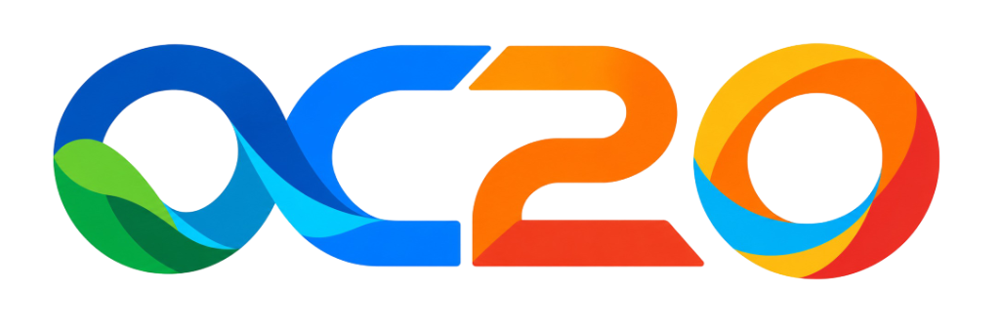

# OC2O UTILITEY - INFINITY SHEETS



> **From OC20 UTILITY TOOLS · [OC2O.CO](https://oc2o.co)**  
> **Live Hosted App**: [https://dbs314.github.io/OC2O-UTILITEY---INFINITY-SHEETS/](https://dbs314.github.io/OC2O-UTILITEY---INFINITY-SHEETS/) (100% Local Browser Data Storage)

**OC2O UTILITEY - INFINITY SHEETS** is an offline-first, Apple VisionOS / macOS inspired infinite whiteboard & sheets workspace engineered for researchers, developers, and AI/LLM workflows.

## Key Capabilities
- **Minimal OC20 Intro & Infinity Sheets Landing Hub (`G`)**: Branded intro animation and full visual sheet browser with live canvas thumbnails, quick templates, search, pin, duplicate, and atmosphere switching.
- **Subtle Nordic Winter Theme**: Glacial twilight canvas (`#08101d` → `#0f1c30`) with icy frost radial light pools and drifting crystalline snowfall motes, alongside *Velvet Aurora*, *Midnight Sapphire*, *Emerald Lounge*, *Champagne Atelier*, and *Pearl Daylight*.
- **Excalidraw-Native Direct On-Canvas Text & Interactive Math Studio**: Type directly on the canvas with live LaTeX/math symbol conversion (`\Psi_i(r) = \delta_0 + \eta^2` → `Ψᵢ(r) = δ₀ + η²`) and a contextual Greek & Calculus symbol ribbon.
- **Visio-Grade Smart Shapes & Magnetic Connectors**: 4-direction `+` quick-branch ports, Straight / 90° Elbow / Curved Bézier connectors, and 1-click shape morphing (`Text ↔ Box ↔ Pill ↔ Diamond ↔ Circle ↔ Sticky Note`).
- **Tab-Linked Prescribed Harmonic Colours**: Press `Tab` (or click the 5 glowing jewel orbs) to cycle through curated harmonic palettes.
- **LLM Paste & Multi-Language Code Studio**: Paste directly from Gemini or ChatGPT (`Ctrl+V`) to auto-format equations, titles, and syntax-highlighted code cards.

## Quick Start

```bash
npm install
npm run dev
```

Build for production:

```bash
npm run build
```
